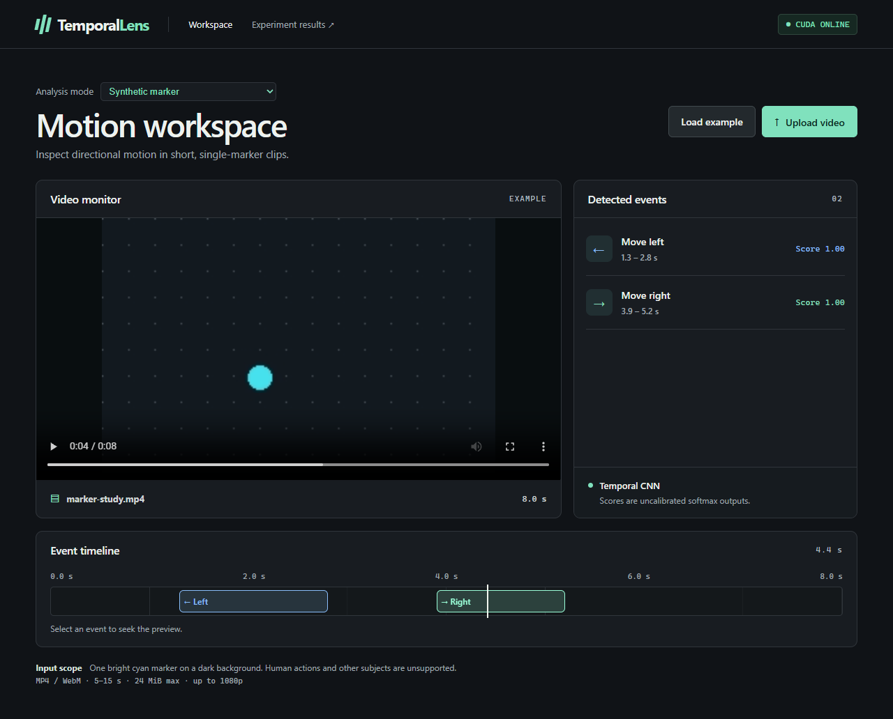
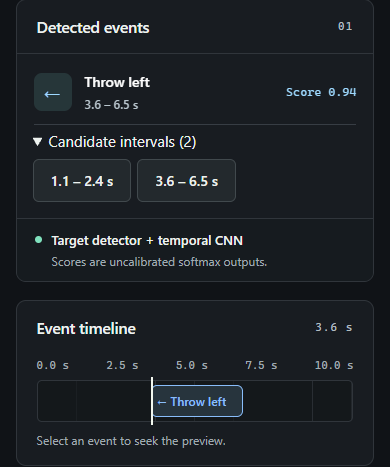

# TemporalLens

I built TemporalLens around a question I could test with a dot on a screen. A still image tells me where the dot is. Could a model use a short sequence to tell me which way it moved, when it stopped, and which movement came next?

The project includes the experiments and a local app for inspecting their predictions. The marker experiment worked well enough that I tried the same question on four filmed hand gestures. On a whole recording, the gesture model often missed a motion I could see or labeled an unrelated one. In the app I can click a prediction to replay the evidence, or inspect a clip where the timeline is empty.



## Try it locally

From the repository root, create a Python 3.13 environment with `python -m venv .venv`. Activate it with `.\.venv\Scripts\Activate.ps1` in PowerShell or `source .venv/bin/activate` on Linux. For a CPU installation on either platform, run the following commands.

```shell
python -m pip install torch==2.9.1 --index-url https://download.pytorch.org/whl/cpu
python -m pip install -r requirements.txt
python -m uvicorn temporallens.api:app --host 127.0.0.1 --port 18731
```

Open the workspace and play the bundled eight-second example. Click a timeline block or event row to seek. You can also upload a local MP4 or WebM lasting 5–15 seconds, up to 24 MiB. Scores are uncalibrated. [Open the local app](http://127.0.0.1:18731)

To enable the two experimental real-video modes, **IPN pilot** and **two-stage pilot**, stop the server, run the two commands below, then restart it. Setup downloads and verifies the frozen encoder once. Inference runs locally. [CUDA setup and research reproduction](docs/reproduction.md)

```shell
python -m pip install -r requirements-gesture.txt opencv-python-headless==4.12.0.88
python -m research.ipn_setup
```

## From a moving marker to a moving hand

I generated 396 marker clips with known boundaries. On 96 held-out scenes, the independent-frame model recovered **4/96** complete ordered event lists. The five-frame model recovered **96/96**, and an untrained velocity rule recovered **83/96**. When I cut and swapped the two movements, the temporal model often read the jump at the edit as another movement. Its exact-list score fell to **25/96**. Rerendering the same order along a continuous path restored **96/96**. [Marker results, interventions and failure examples](docs/evaluation.md)

I chose IPN Hand because its continuous recordings include the time between prompted gestures. Each of the 56 recordings I selected contains a throw left, throw right, zoom in and zoom out. I kept both recordings from each participant together, with 16 people for training, four for validation and eight for testing. I checked backgrounds and duplicate frames. The dataset does not identify physical rooms reliably. [Dataset card and split provenance](docs/dataset-card.md)

| IPN Hand model | Macro F1 given true boundaries | Correctly labeled and localized / 64 | False alarms | Stream segment F1 |
|---|---:|---:|---:|---:|
| Independent-frame MLP | .511 | 0 | 19 | .000 |
| Pooled visual features | .344 | 1 | 18 | .024 |
| Optical-flow classifier | .534 | 0 | 0 | .000 |
| Temporal CNN | .404 | 2 | 93 | .025 |
| Two-stage, validation-selected CNN | .404 | 2 | 62 | .031 |
| Two-stage, fusion comparison | .457 | 9 | 92 | .109 |

For known-boundary macro F1, I supplied the gesture interval and asked for one of four labels. The stream columns score all 16 complete test recordings. I count a match when the class is correct and the predicted interval $P$ overlaps the reference interval $R$ enough to give $\mathrm{tIoU}(P,R)=|P\cap R|/|P\cup R|\geq 0.50$. Every model recovered **0/16** complete event lists. The flow classifier abstained on every stream. [Recognition, detection and participant-level uncertainty](docs/ipn-results.md) · [Two-stage comparison](docs/two-stage.md)

I had set a target of a .05 gain over the appearance controls on both recognition and stream F1, plus a ten-percentage-point loss under shuffling. The CNN missed those targets. Shuffling the frames of isolated gestures reduced its accuracy by only 3.1 points. Giving the models two known clips and two possible labels made ordering much easier, even for the frame baseline. [Prespecified comparisons](docs/ipn-protocol.md)

## Where the two-stage detector helped

Before assigning labels, the new detector localized **24/64** gestures at IoU .50. The original decoder located **3/64** with its labels ignored. Of the 24 matched proposals, the selected CNN rejected 20, mislabeled two and accepted two correctly. The paired 95% interval for its change in stream F1 was **−.012 to +.050**. Fusion did better on the old test recordings but ranked lower on validation. I kept the validation selection. [Candidate counts and failure analysis](docs/two-stage.md)



*I used a validation clip with a detectable gesture to check the interface. The model labeled 3.60–6.53 s as throw left. The annotated interval was 4.07–5.97 s. The screenshot shows the app’s results panels. The source footage stays local.*

I then fixed the candidates and examined rejection on training and validation participants. Only eight validation proposals matched a gesture at IoU .50. A margin rule reduced false acceptances from four to two and recovered the same two correct labels. Temperature scaling worsened calibration on matched gestures. A small head trained with verified background intervals rejected everything at its selected cutoff. I stopped there. [Validation-only diagnostic](docs/candidate-rejection.md)

Next I would test whether the change in hand appearance from the beginning to the end of a proposal can distinguish opposite motions when its boundaries are imperfect. I would first measure that on development participants, then freeze the design and collect an independent evaluation with documented rooms. The eight previously held-out people have already appeared in both real-video evaluations. They can serve as a regression benchmark. A future claim about generalization needs fresh participants.

## Licensing

The repository includes experiment protocols, weights, numeric predictions and figures. The real-video modes cover four prompted gestures and can miss all gestures in a clip or label unrelated movement. [Model card](docs/model-card.md) · [Architecture](docs/architecture.md) · [Equations](docs/math.md) · [Reproduction](docs/reproduction.md)

I release the original code and synthetic assets under MIT. The IPN-derived heads, measurements and figures have separate CC BY 4.0 attribution. The optional DINOv2 encoder is Apache-2.0. The screenshots come from the running application. [License](LICENSE) · [Attribution and upstream rights](NOTICE.md)

## Let's Connect

If you’re working on computer vision or sequence modeling, I’d love to compare notes on how you tell whether a temporal model has learned motion. I can explain how I built the experiments and timeline, the tools I used, and the math behind scoring overlapping intervals. I’m happy to talk through why I split detection from recognition, which findings held up, and what the gap between synthetic clips and real video taught me.

Questions about the project are welcome. [Find me on GitHub](https://github.com/sslcat).
