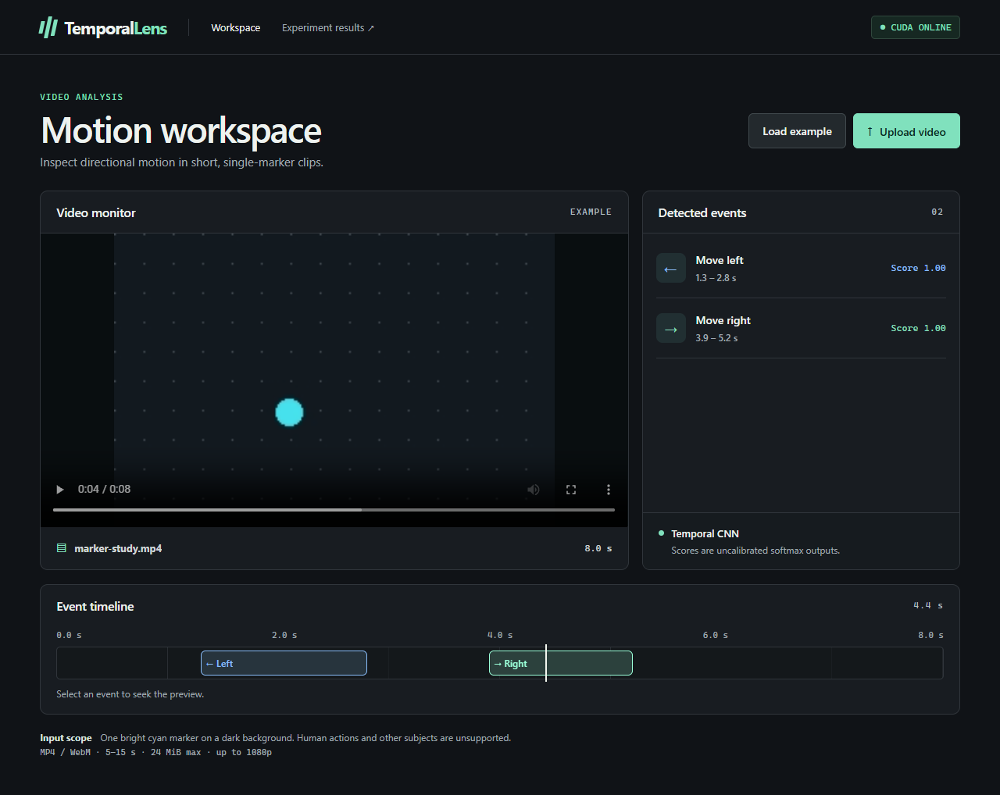

# TemporalLens

I built TemporalLens to test a question that a video caption alone cannot answer. If a single frame shows a marker halfway across a screen, can a model tell which way it is travelling, when it started, and which movement happened next?

TemporalLens is a local FastAPI application with two PyTorch experiments. Its synthetic mode follows a cyan marker moving left, right, up or down. Its experimental real-video mode detects four touchless hand gestures. The UI previews a short video, runs the released temporal checkpoint and places each detected event on a seekable timeline. The bundled eight-second example comes from the held-out set.



## Run locally

The release includes trained weights. In the prepared Windows checkout, run the following from PowerShell.

```powershell
cd D:\TemporalLens
.\.venv\Scripts\python.exe -m uvicorn temporallens.api:app --host 127.0.0.1 --port 18731
```

Open [TemporalLens on localhost](http://127.0.0.1:18731). Select an entry in the event list or timeline to seek. Upload limits are 24 MiB, 5–15 seconds and up to 1080p worth of pixels. The model uses CUDA when available. Set `TEMPORALLENS_DEVICE=cpu` to run on CPU. For a fresh checkout, follow [environment setup and reproduction](docs/reproduction.md).

## Real-video pilot

I trained a frozen-feature gesture system on original IPN Hand recordings and tested it on eight held-out participants. Known-boundary macro F1 was .511 for the independent-frame head, .344 for the pooled head, .404 for the temporal CNN and .534 for classical flow. Locating gestures in continuous footage was much harder. The CNN matched 2 of 64 events at IoU .50, produced 93 unmatched detections and recovered 0/16 complete lists. Shuffling isolated gestures reduced its accuracy from 43.8% to 40.6%. These results fell short of the temporal advantage I had set out to measure.

Select **Real hand gestures · IPN pilot** for throw left, throw right, zoom in and zoom out. It displays uncalibrated scores and can return an empty timeline. A fresh checkout needs the optional local encoder. [Setup](docs/reproduction.md) · [Curves, confusion matrices and failure cases](docs/ipn-results.md) · [IPN Hand attribution](artifacts/ipn/NOTICE.md)

## Synthetic marker experiment

| 96 held-out clips, 192 movement events | Independent frame | Temporal CNN |
|---|---:|---:|
| Event accuracy with known boundaries | 27.1% | 100% |
| Macro F1 with known boundaries | 0.230 | 1.000 |
| Complete ordered list with predicted boundaries | 4/96 | 96/96 |
| Mean same-class temporal IoU | 0.092 | 0.997 |

The two models use the same per-frame position measurements. With a five-frame neighborhood, the model learned to distinguish opposite directions. Reversing the sequence flipped every oracle-window direction prediction. Shuffling frames reduced its accuracy to 27.1%.

The clean accuracy hid a useful failure. When I exchanged the two halves by making an edit, the temporal model often treated the jump at the join as a third movement. It recovered only 25/96 complete lists. Rerendering the exchanged directions along a continuous path restored 96/96. A simple untrained velocity rule already solved direction classification and recovered 83/96 clean lists. What the experiment taught me was to score every extra detection, inspect edit boundaries and include a nonlearned motion control. [Measurements, figures and failure analysis](docs/evaluation.md)

## Research and implementation

- [Real-video feasibility study and proposed pilot](docs/real-video-feasibility.md)
- [Hypotheses fixed before training](docs/protocol.md)
- [Dataset card, licensing review and split provenance](docs/dataset-card.md)
- [Model card and supported inputs](docs/model-card.md)
- [Application architecture](docs/architecture.md)
- [Training procedure](docs/training.md) and [mathematical details](docs/math.md)
- [Reproduction, tests and local browser check](docs/reproduction.md)
- [Experiment records and checkpoints](artifacts/)

The two synthetic fits took 5.55 seconds on the local RTX 4070 SUPER and the larger fit peaked below 10 MiB of allocated tensors. The 20 real-video pilot fits took 31.95 seconds and peaked at 847.73 MiB. Cloud setup and transfer offer no demonstrated benefit at this scale. Runpod spend for this project was $0.

## License and assistance

I release the original code, synthetic data, marker checkpoints and marker figures under the [MIT license](LICENSE). The real-video heads and derived pilot artifacts carry [separate attribution and terms](artifacts/ipn/NOTICE.md). External libraries have their own terms. I used OpenAI Codex to help design, implement, run, test and document the work. The curves, confusion matrices and examples were generated from the local run. [Attribution notices](NOTICE.md)

## Let's Connect

[GitHub · sslcat](https://github.com/sslcat)
