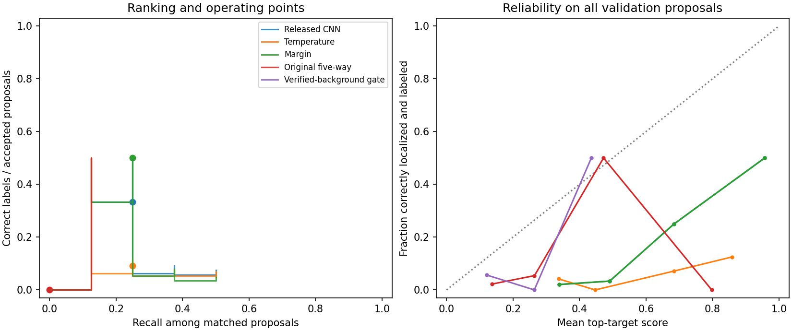
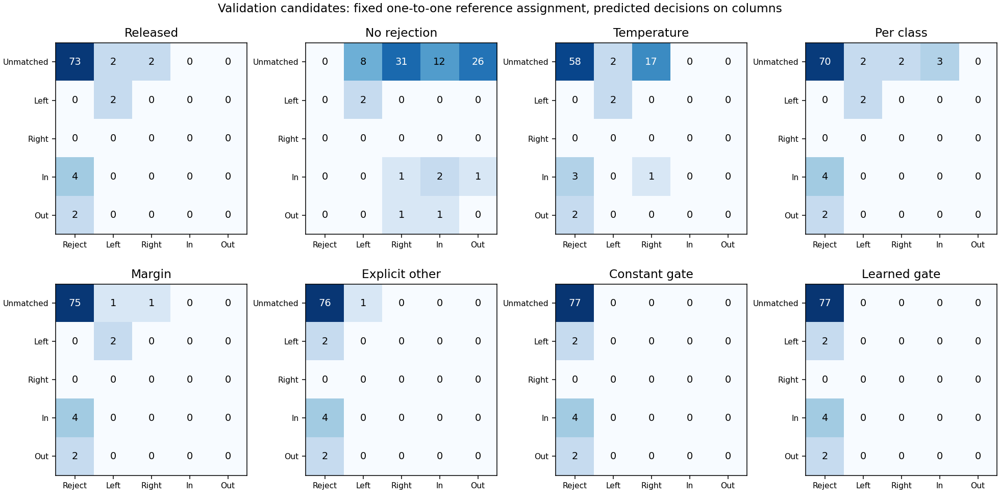

# Why the gesture classifier rejects candidates

I retained the released decision rule. On validation, relaxing rejection could recover two correctly named zoom-in gestures, both from the same person. Four other well-localized gestures already had the wrong top label. A stricter margin reduced false acceptances, but every method fell short of the improvement I specified before fitting. [Decision protocol](rejection-protocol.md) · [Machine-readable outcomes](../artifacts/rejection/results.json)

## What I compared

I used the selected hybrid proposal detector and existing CNN from local release `e91a55f`. I locked the comparisons and stopping rule at `2a27472`. I used exactly 32 training recordings from 16 participants and eight validation recordings from four different participants. The loader allowlisted development caches and recorded all 40 it opened. I verified the frozen component hashes, reproduced every previous validation proposal in order and reproduced the released event decisions source by source. The old test recordings and their result files were outside this analysis.

I matched candidate and reference intervals once, ignoring class and requiring IoU ≥ .50. There were 360 training proposals and 85 validation proposals. In training, 103 matched, 236 had zero target overlap and 21 overlapped a target without qualifying. In validation the corresponding counts were **8, 67 and 10**. I used the original annotation rows to check all frames in each candidate against cached labels. Among the 236 verified training negatives, 11 contained only annotated non-gesture time, 175 only unsupported movements and 50 a mixture. I excluded the 21 ambiguous training candidates from the binary fit and included all 85 validation candidates in evaluation.

Candidate precision is the number of correctly named matches divided by the number of accepted proposals. Candidate recall divides correct labels by the eight localized gestures. Stream recall also counts the 24 reference gestures without a matched proposal. A candidate with the wrong gesture label contributes both a false positive and a false negative. The true class of an unmatched candidate is zero for this scoring task, including partial overlaps. I kept the four-way CNN label ranking fixed to isolate rejection decisions.

## What the logits show

| Frozen CNN diagnostic | Train | Validation |
|---|---:|---:|
| Correct top label on a matched proposal before rejection | 78/103 | 4/8 |
| Correct matched labels retained at .60 | 49/103 | 2/8 |
| Median top-target probability on matched proposals | .620 | .447 |
| Median top-target probability on verified other proposals | .483 | .367 |
| Median winning target logit minus other logit on matches | +.569 | −.489 |
| Five-way background logit wins on matched proposals | 37/103 | 6/8 |
| Five-way background logit wins on verified other proposals | 193/236 | 59/67 |

**Wrong classes and rejection.** The eight validation matches contained two throw-lefts, zero throw-rights, four zoom-ins and two zoom-outs. Both throw-lefts passed. Two zoom-ins had the correct top label with scores of .412 and .351 and were rejected. The remaining two zoom-ins and both zoom-outs had the wrong top label. Five of the eight matches came from one participant. In the original rule, two of the four false acceptances came from verified non-targets and two from partial overlaps. The matched set provides no direct estimate of throw-right recall.

**Interval alignment.** I rescored each matched candidate using the exact annotated interval with the same continuous-stream logits. All eight kept the same top label. The median change in true-class probability was −.004. One incorrect label crossed the acceptance threshold and neither rejected correct gesture was rescued. Boundary error was therefore a weak explanation for rejection in these eight cases. This paired check cannot explain the 24 validation gestures that the detector never localized.

**Feature distribution.** For each pooled DINO embedding I measured the cosine distance to the nearest training candidate of the same stratum. I excluded the same participant from the training reference comparisons. On matched proposals the median distance was .191 within training and .280 from validation to training. On verified negatives the medians were .144 and .281. On matches the median absolute per-coordinate mean shift was .64 training standard deviations for the DINO vector and .36 for the pooled head logits. These observations are consistent with a feature shift. The training data also contributed to fitting the original models. Different subjects, gesture composition and in-sample fitting can all contribute to the gap. I cannot assign it a single cause. [Score quantiles, alignment pairs and shift measurements](../artifacts/rejection/root-causes.json)

## Operating points on validation participants

For every learned threshold or temperature, I fitted it on the other three validation participants and applied it to the fourth. I pooled the excluded-participant decisions below. The underlying detector had already been selected using these four people in the prior study. These numbers compare development options and do not establish performance on unseen data.

| Rule | Correct / accepted | Precision | Candidate recall | Candidate F1 | Stream F1@.50 | False alarms/min |
|---|---:|---:|---:|---:|---:|---:|
| Released .60 cutoff | 2 / 6 | .333 | .250 | .286 | .105 | .23 |
| Accept every candidate | 4 / 85 | .047 | .500 | .086 | .068 | 4.68 |
| Tuned global cutoff | 1 / 4 | .250 | .125 | .167 | .056 | .17 |
| Temperature and .60 cutoff | 2 / 22 | .091 | .250 | .133 | .074 | 1.16 |
| Per-class cutoffs | 2 / 9 | .222 | .250 | .235 | .098 | .40 |
| Top-two probability margin | 2 / 4 | .500 | .250 | .333 | .111 | .12 |
| Original explicit background logit | 0 / 1 | .000 | .000 | .000 | .000 | .06 |
| Constant target-presence prior | 0 / 0 | undefined | .000 | .000 | .000 | .00 |
| Learned background gate | 0 / 0 | undefined | .000 | .000 | .000 | .00 |

The margin rule was the most precise operating point that recovered any correct gestures. Its candidate F1 gain was .048, and it added zero correct gestures. Removing rejection doubled the number correct, but admitted all 77 unmatched proposals plus four wrong labels. With the released rule, training candidate precision/recall were .405/.476. Removing rejection gave .217/.757 on training.



The precision–recall curves sweep distinct score values, resolving ties together. For rules with explicit background, a candidate must first beat background. Average precision for correct localized labels was .146 for the original target ranking, .141 for the probability margin and .096 for the fold-scaled temperature scores. The fixed threshold and class-specific thresholds share the same original score ranking. The operating point and average precision answer different questions. [Fold parameters, decisions by participant, PR coordinates and all confusion matrices](../artifacts/rejection/results.json)



## Calibration and the background fit

The CNN's four-way softmax assumes a target is present. On the eight matched movements alone, the released logits gave four-class negative log likelihood of 1.025, multiclass Brier score of .580 and five-bin top-label expected calibration error (ECE) of .110. Temperature scaling fitted to matched examples in the other three participants produced temperatures from .518 to 1.149. It worsened the corresponding held-participant measurements to 1.164, .644 and .266. Calibration folds had only three to seven matched examples.

Over all 85 proposals I also measured whether the top target name was a correct localized event. Original-score ECE was .376 and binary Brier score was .187 for that question. After temperature scaling the values were .416 and .241. This second measure also reflects missing target-presence information. Low all-candidate ECE can coexist with rejecting every true gesture when unmatched proposals dominate. Five-bin estimates from eight conditional examples are particularly unstable.

**One revised head.** The verified training proposals met the predeclared support requirement in all 16 people. I fitted a 21-parameter binary logistic gate to the 20 cached visual/flow logit features, with balanced binary loss, train-only standardization and fixed L2 penalty .05. The original four-way class scores remained fixed. The gate estimated presence and multiplied each conditional class probability by that estimate. I compared the winning target against background and the same threshold grid used for the original five-way CNN. A constant gate used the eligible training target fraction, 103/339.

On matched versus verified-negative training proposals, the learned gate's presence ROC AUC was .817. On the eight validation matches versus 67 verified negatives it was .582. The original five-way CNN's target-presence AUC was .823 on training and .631 on validation. The learned gate's median validation presence scores were .493 on matches and .432 on negatives. Its validation presence Brier score was .226, versus .134 for the constant prior and .260 for the original five-way model. Fitting background examples gave some ranking above the constant control, but it failed to improve validation discrimination over the original CNN. Only five proposals beat the learned background score on the joint target decision, and none was a correctly named match. All four folds chose the .60 cutoff and rejected every proposal. I kept the gate checkpoint as diagnostic evidence.

## Decision and reproduction

The locked rule required at least two more correct matches, a .05 candidate F1 gain, gains in at least two validation people and at most .25 additional false alarms per minute. None passed. I stopped after the single gate, kept the existing application configuration and did not evaluate the old test cohort. The strongest limitation is the eight localized validation gestures, including five from one person and none for one target class.

In the prepared pilot environment, the following commands regenerate the diagnostics and verify the numerical outputs. The study requires the existing original annotation file, cached train/validation features and frozen component heads. New outputs live under `artifacts/rejection/`. The replay checks every fitted tensor, all candidate decisions, the fold settings, and every numeric field of the three JSON reports. Wall-clock time is recorded separately.

```powershell
python -m research.rejection_study
python -m research.rejection_study --replay
python -m research.rejection_figures
python -m pytest -q
```

The full suite passed all 36 tests, including seven new cases for split isolation, verified labels, one-to-one assignment, rejection scoring, calibration fallbacks and the stopping rule. The deterministic replay reproduced all reported numerical decisions and all gate tensors.

The measured local diagnostic took 2.42 seconds in its timed section and peaked at 268.01 MiB of PyTorch allocation on the RTX 4070 SUPER. I used OpenAI Codex for implementation, analysis and documentation. [Per-candidate logits and decisions](../artifacts/rejection/candidates.json) · [Artifact attribution](../artifacts/rejection/NOTICE.md)
