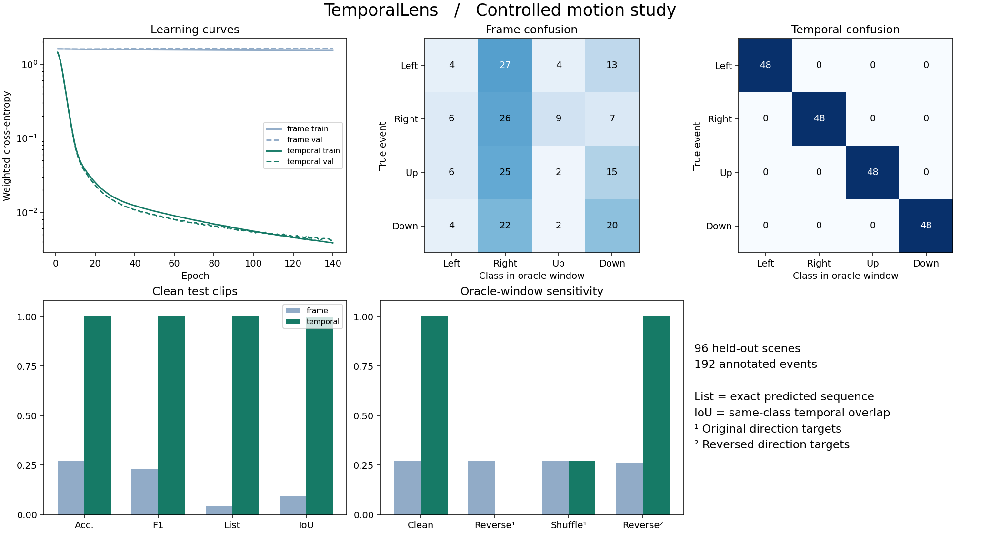

# Held-out evaluation

I froze both checkpoints using validation loss before evaluating the 96 held-out scenes. Each clip contributes two actions. I evaluate classification on true action windows and ordered-list recovery on uninterrupted videos with unknown boundaries. These measurements answer different questions. [Protocol](protocol.md) · [Full machine-readable results](../artifacts/metrics.json)

| Metric | Independent frame | Temporal CNN |
|---|---:|---:|
| Oracle event accuracy | 27.08% (52/192) | 100% (192/192) |
| Oracle macro F1 | 0.2297 | 1.0000 |
| Exact ordered sequence | 4.17% (4/96) | 100% (96/96) |
| Unordered multiset correct | 4.17% | 100% |
| Mean best same-class temporal IoU, including misses | 0.0922 | 0.9973 |
| Matched events | 77/192 | 192/192 |
| Mean absolute endpoint error on matches | 1.9974 s | 0.00234 s |
| Median / 95th percentile model forward | 0.170 / 0.438 ms | 0.214 / 0.374 ms |
| Median / 95th percentile decode + inference + grouping | 15.05 / 23.19 ms | 13.95 / 18.72 ms |
| Fit time / peak allocated CUDA memory | 2.26 s / 7.57 MiB | 3.30 s / 9.93 MiB |

I used 100 synchronized batch-one forward measurements after ten warmups. The pipeline timings use the first 24 held-out files and exclude HTTP transfer. The small pipeline timing differences are sensitive to cache state and desktop load. The model emits boundaries on a 100 ms grid. The small **mean** endpoint error arises because most endpoints land on the exact reference tick.

## Uncertainty and per-class results

Paired scene bootstrap 95% intervals for the temporal-minus-frame differences were +0.728 to +0.816 macro F1, +0.917 to +0.990 exact-list accuracy and +0.889 to +0.922 mean IoU. The temporal model’s IoU interval was 0.9955–0.9988. Bootstrap intervals for perfect observed accuracy collapse to one. An approximate 95% Wilson interval for 96/96 independent scene successes is 96.2–100%. I used one training seed and one renderer family. These intervals describe scene sampling within that family.

| Direction | Test count | Frame F1 | Temporal F1 |
|---|---:|---:|---:|
| Left | 48 | 0.118 | 1.000 |
| Right | 48 | 0.351 | 1.000 |
| Up | 48 | 0.062 | 1.000 |
| Down | 48 | 0.388 | 1.000 |

## How much does frame order matter?

| Intervention | Frame | Temporal |
|---|---:|---:|
| Original sequence, original direction | 27.08% | 100% |
| Reverse, score against original direction | 27.08% | 0% |
| Reverse, score against the opposite direction | 26.04% | 100% |
| Shuffle, realign outputs to original frames | 27.08% | 27.08% |
| Swap bouts by splicing, exact full list | 0/96 | 25/96 |

The first four rows evaluate event recognition on oracle windows. The reversed and shuffled controls retain all observations. The direction head follows the sign of the motion on reversal, and random permutation removes its advantage. H1, H2 and H3 crossed their preregistered thresholds. Matching both the set and order on clean clips leaves no cases that isolate a clean permutation error. The model reads a short neighborhood and reports detected runs chronologically. The experiment establishes local motion sensitivity and ordered detection within this generator.

## What failed

The temporal head correctly found left then right in scene 30000. In scene 30040 it extended an upward movement to 5.1 s when the renderer stopped at 5.0 s. The figure shows both heads against truth for the best and worst temporal IoU examples. [Actual held-out timelines and decoded frames](../artifacts/cases.png)

The cut-and-splice control exposed a more consequential failure. All 71 incorrect sequences contained a prediction at the join. In scene 30000 the join jumps the marker’s position at 4.7 s. The model inserted a rightward event from 4.6–4.9 s between the two genuine movements. Oracle-window accuracy on spliced clips still reached 100%. Ground-truth-centric IoU also remained high because it overlooks additional detections. [Observed splice failure](../artifacts/splice-failure.png)

I ran two **post-hoc diagnostics** after seeing the splice result. I kept the weights and thresholds fixed. First I rerendered the same held-out scene seeds with the two directions exchanged and a continuous path. The temporal head recovered 96/96 new lists with 0.9950 mean IoU. Together, the two controls implicate the discontinuity at the edit. These rerenders reuse scene seeds and do not add independent subjects or independent test samples.

Second I classified the native-pixel centroid displacement from the previous tick by its dominant signed axis, assigning still below 0.5 pixels. This untrained control also recognized every oracle event. It recovered 83/96 complete sequences (86.46%) and scored 0.9455 mean IoU. On this clean task the learned head’s advantage over that simple motion rule was in segmentation and sequence recovery. Its advantage over single frames was much larger. [Control results](../artifacts/controls.json)
