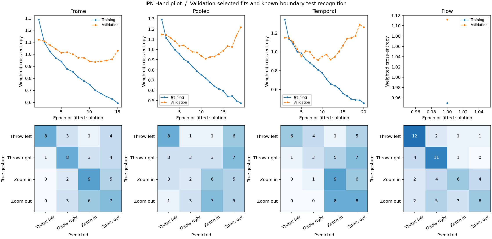
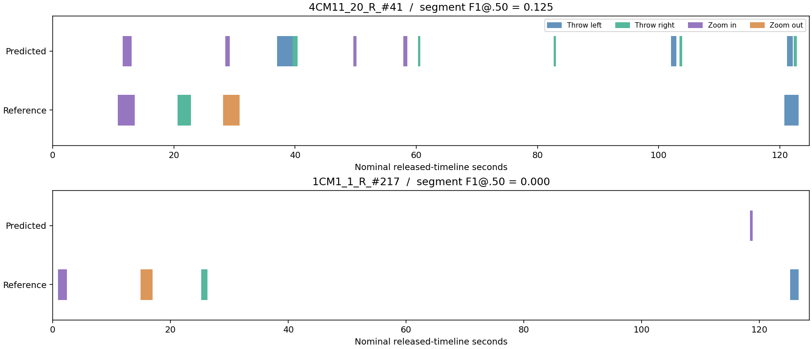

# Real-video gesture pilot

I could classify some real gestures when I knew when to look. I could rarely locate them in an uninterrupted recording from a held-out participant. The frame MLP and the classical flow classifier both beat the temporal CNN on known-boundary macro F1. None recovered a complete natural event list. I kept the validation-selected models and exposed the temporal model as an experimental application mode. [Locked protocol](ipn-protocol.md) · [Measured results](../artifacts/ipn/evaluation.json)

## Cohort and unit of analysis

I used 56 complete IPN Hand recordings from 28 participant groups. Each has one throw left, throw right, zoom in and zoom out. There are **224 target events**. Other includes deliberate, unsupported gestures as well as intervals with no annotated gesture. I retained these intervals during training and detection. The held-out set has 64 movements across about 34.9 nominal minutes. [Split with source IDs](../artifacts/ipn/split.json)

| Split | People | Recordings | Events per target | Original annotated frames | Sampled ticks | Other ticks |
|---|---:|---:|---:|---:|---:|---:|
| Train | 16 | 32 | 32 | 129,040 | 32,273 | 30,140 |
| Validation | 4 | 8 | 8 | 31,156 | 7,792 | 7,360 |
| Test | 8 | 16 | 16 | 62,791 | 15,703 | 14,816 |

Training made 378 contiguous chunks per epoch. Validation and primary testing ran on continuous streams. I also evaluated 166 nonoverlapping 12-second test clips and eight pair-enriched crops of about 15 seconds. These excerpts reuse sources. The bootstrap resamples the eight test participant groups, preserving both recordings together. Camera setup was inspected visually. Physical-room disjointness remains unverified.

## Recognition and full-stream detection

The table reports the prespecified primary neural seed 17. Oracle recognition receives the true interval and a choice among the four gestures. Natural-stream detection receives only the frames. It must distinguish other and find both endpoints. Each unmatched prediction counts as a false alarm. Mean endpoint error uses only one-to-one same-class matches at IoU ≥0.50.

| Head | Oracle accuracy | Oracle macro F1 [95% participant bootstrap] | Segment F1 @.10 / .25 / .50 | Matches / 64 | False alarms / nominal min | Endpoint MAE, frames | Exact lists |
|---|---:|---|---|---:|---:|---:|---:|
| Frame MLP | 50.0% | .511 [.417, .577] | .072 / .048 / .000 | 0 | .545 | undefined | 0/16 |
| Pooled features | 34.4% | .344 [.242, .432] | .024 / .024 / .024 | 1 | .516 | 10.00 | 0/16 |
| Temporal CNN | 40.6% | .404 [.285, .510] | .088 / .088 / .025 | 2 | 2.666 | 17.75 | 0/16 |
| Flow logistic regression | 54.7% | .534 [.365, .669] | .000 / .000 / .000 | 0 | .000 | undefined | 0/16 |

The CNN produced 95 segments. Two matched, 93 were false alarms and 62 reference events were missed. Its mean endpoint error of 0.59 nominal seconds describes just those two matches. Its mean best same-class IoU over **all** reference events was .045. The flow model assigned useful relative scores within known intervals, but its validation-selected decoder abstained throughout the test streams. Raw five-class tick macro F1 ranged from .238 to .249 across the four models. A time-only class prior estimated from the training streams reached .217 oracle macro F1. [Supplementary diagnostics](../artifacts/ipn/diagnostics.json)

| Oracle precision / recall | Throw left | Throw right | Zoom in | Zoom out |
|---|---:|---:|---:|---:|
| Frame MLP | .889 / .500 | .500 / .500 | .474 / .563 | .350 / .438 |
| Pooled features | .533 / .500 | .333 / .188 | .353 / .375 | .217 / .313 |
| Temporal CNN | .857 / .375 | .375 / .188 | .391 / .563 | .308 / .500 |
| Flow | .600 / .750 | .500 / .688 | .545 / .375 | .545 / .375 |

I saw no reliable temporal improvement. For CNN minus frame MLP the paired 95% interval was −.240 to +.036 on oracle macro F1 and .000 to +.055 on segment F1@.50. The CNN's segment F1@.50 bootstrap interval was .000–.055. Across seeds 17, 31 and 73 its oracle macro F1 was .404, .454 and .362. Segment F1@.50 was .025, .068 and .064. A participant bootstrap with eight groups is coarse and does not quantify transfer to a new dataset.

## Frame order and precedence

For this control I isolate each of the 64 real bouts, reset context at its edges and score against its original label. The pooled head sees a whole-bout mean. Optical flow is recomputed after changing frame order. Reversing a person's hand motion can change its meaning or make it unnatural. These columns measure sensitivity to the intervention.

| Head | Clean accuracy | Reverse | Shuffle | AB/BA, two labels supplied | AB/BA, both top-1 labels correct |
|---|---:|---:|---:|---:|---:|
| Frame MLP | 50.0% | 50.0% | 50.0% | 168/192 | 38/192 |
| Pooled features | 39.1% | 39.1% | 39.1% | 148/192 | 24/192 |
| Temporal CNN | 43.8% | 34.4% | 40.6% | 164/192 | 32/192 |
| Flow | 53.1% | 48.4% | 40.6% | 168/192 | 54/192 |

The CNN lost only 3.1 percentage points under shuffling, below the 10-point sensitivity target. In AB/BA there are six unordered pairs per recording and two presentations of the same frames. The supplied-label readout assigns two known labels to two known bouts. Even the independent-frame head scores 87.5% under that hint. The CNN’s 85.4% falls to 16.7% when both top-1 labels must be correct. No primary model exactly recovered any full source, any of the four blind tiles containing multiple visible targets, or any of the eight naturally occurring enriched pairs. For the CNN, zero held-out sources had two matched detections at IoU .50, so conditional precedence accuracy on localized pairs is undefined. [Baselines and sensitivity figure](../artifacts/ipn/comparisons.png)

I also joined the actual sampled bouts end to end in both orders and ran each frozen model across the cut. This supplementary test lets the temporal filters see the splice. I recomputed flow at the new transitions. There are 96 pairs and 192 presentations. Only the last two columns use the ordinary detector with its validation threshold and no supplied boundaries.

| Head | Correct with labels and boundaries | Both labels correct with boundaries | Exact decoded lists | Both orders decoded correctly |
|---|---:|---:|---:|---:|
| Frame MLP | 168/192 | 38/192 | 2/192 | 1/96 |
| Pooled features | 153/192 | 14/192 | 0/192 | 0/96 |
| Temporal CNN | 162/192 | 30/192 | 4/192 | 1/96 |
| Flow | 151/192 | 49/192 | 0/192 | 0/96 |

The two presentations share every frame. Adjacent gestures in these constructed clips have a hard cut and no intervening background activity. I count them separately from the uninterrupted recordings. [Joined-pair implementation](../research/ipn_diagnostics.py)

## Where it failed

In source `4CM11_20_R_#41` the CNN found a zoom-in from frames [348,392) inside the annotated [322,406). Eleven additional detections failed to match at IoU .50. In `1CM1_1_R_#217` it missed all four gestures and predicted a short zoom-in near the end. The reference there contained a throw-left later in that recording. The two traces show the highest- and lowest-scoring sources by segment F1@.50, with ties broken by source ID.

Most sampled training ticks belong to other. At test time hands can move during those intervals. Tiny changes in finger shape, mirrored viewpoints, a small number of people and unfamiliar backgrounds are plausible sources of error. The experiment does not isolate their individual effects. Few clean short pairs survived the blind tiling rule. I did not expand the test cohort or adjust thresholds after examining its predictions.

## Local compute and verification

I used the RTX 4070 SUPER for the frozen DINOv2 encoder and all four fitted heads. Classical flow extraction and video decoding ran on the local CPU. The feature pipeline took 206.15 s including motion features and the near-copy search, with a 151.76 MiB peak PyTorch allocation in its measured section. All 20 candidate fits summed to **31.95 s**. Peak training allocation was **847.73 MiB**, including cached GPU inputs. The training monitor obtained 38 board-wide GPU utilization samples with median 41.5% and maximum 60%. Other desktop workloads can contribute to these readings. [Training histories and monitor samples](../artifacts/ipn/training.json)

| Primary head | Trainable parameters | Selected epoch / solution | Fit seconds | Released checkpoint bytes |
|---|---:|---:|---:|---:|
| Frame MLP | 136,037 | 8 | 3.35 | 561,469 |
| Pooled | 136,037 | 12 | 1.49 | 561,493 |
| Temporal CNN | 135,749 | 13 | 1.78 | 559,231 |
| Flow | 725 | L-BFGS solution | 0.81 | 6,271 |

I repeated all ten selected fits (three seeds per neural head and one flow fit). Every fitted tensor, loss history and validation decoder choice matched exactly. I also reproduced the cached neural and motion features for all 938 sampled frames of training recording `1CM1_4_R_#229`. A second run reproduced the complete primary evaluation JSON byte for byte. The local automated suite passed all 24 tests. I exercised the real upload, empty detection state, malformed-file recovery, event-list and timeline seeking and switching back to the synthetic demo in Edge at 1280 px and 390 px. The positive QA clip was selected from validation: the seventh candidate produced the expected throw-left at 4.40–5.87 s with an uncalibrated score of .907. The corresponding original annotation spans 4.07–5.97 s in the crop. Ten warm local requests on this 10-second clip had a median latency of 269 ms including upload, decode and inference. I used this case for application verification only. [Request timings](../artifacts/ipn/app_latency.json)
