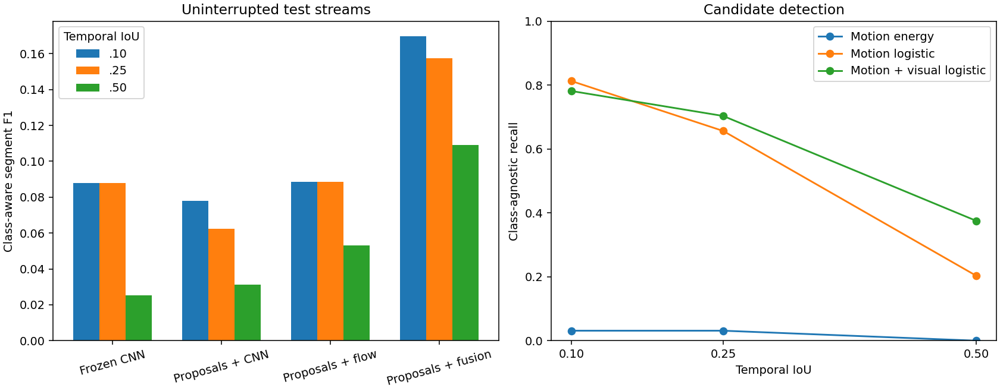
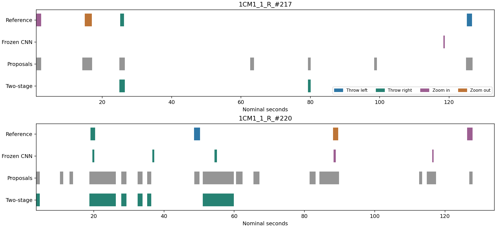

# IPN Hand follow-up: locating a gesture before naming it

I tried separating two decisions the original pilot made on every tick. First I ask whether an interval might contain any supported gesture. Then I assign a gesture label to the whole interval or reject it. The validation-selected system still matched only two of 64 test gestures. It made fewer false alarms. Most of the additional usable proposals were lost during classification.

## Data and selection

I used the same original frame annotations, frozen DINOv2-S/14 embeddings, 7.5 Hz motion cache and 32/8/16 complete recordings as the first real-video pilot. Each recording contains a throw left, throw right, zoom in and zoom out. Training, validation and test contain 16/4/8 disjoint participant groups. The test set spans 62,791 original frames, about 34.9 nominal minutes. Background setups were inspected for the original split. Physical-room independence remains unverified. [Original data card](dataset-card.md) · [Source manifest](../artifacts/ipn/split.json)

I used validation participants to choose the candidate detector, temporal gap and duration rules, classifier and rejection threshold. The first motion-only search generated 9.13 false candidates per minute on validation. I recorded that result before adding an appearance-assisted logistic detector. I locked all selections and the checkpoint hashes at `a348b9655581cb53b895b309fa80a249911d8f4e` before running the new models on test. This cohort had already been reported in the original study. [Design and amendment](two-stage-protocol.md) · [Validation search](../artifacts/two-stage/search.json) · [Selection](../artifacts/two-stage/selection.json)

## What failed in the original detector

I accounted for all 93 unmatched predictions and all 62 misses of the frozen CNN at class-aware IoU .50. I assigned each error to one category using overlaps on the original frame timeline.

| Relationship to the other list | False alarms | Missed gestures |
|---|---:|---:|
| No temporal overlap with any target or prediction | 76 | 48 |
| Overlap only with the wrong gesture class | 11 | 9 |
| Same class overlaps but falls below .50 IoU | 6 | 5 |

**Motion during other activities.** The midpoints of 30 false alarms fell in annotated non-gesture time and 29 in one- or two-finger pointing. I measured the share of border pixels whose grayscale value changed by more than 12 between samples. Among the 76 predictions wholly outside target intervals, 12 midpoints fell in the high-motion stratum (3,661 other ticks) and 64 in the lower stratum (11,155 other ticks). That is about 0.57 times as many false-alarm midpoints per exposed tick in the high stratum. This proxy provides little evidence of clustering around strong peripheral motion. It cannot attribute a change to the camera, hands, lighting or objects.

**Fragmentation and boundaries.** Of 64 gestures, 48 had no prediction touching them, 13 touched one and three touched two. Splitting gestures into multiple predictions occurred, but explains little of the missing coverage. In 16 class-blind matches at IoU .10, the median predicted start was 21 frames late and the end 14 frames early. The two strict same-class matches alone are too few to establish a population-wide boundary bias.

**Scores and background confusion.** On validation the original .65 threshold plus three-tick run rule found 2/32 gestures with zero false alarms. Lowering it to .45 still found two, with 19 false alarms. Before the run filter, 19/27 threshold-passing target ticks were correct on validation. On test only 50/680 were correct, although their average winning score was .790. There were 567 actual background/other ticks and 63 wrong target labels. Binary target-presence ECE with five equal-width bins rose from .182 to .252. The old scores were unreliable on new participants. Relaxing one global cutoff had already failed on validation. [Validation diagnostics](../artifacts/two-stage/val-failures.json) · [Test diagnostics and reliability bins](../artifacts/two-stage/test-failures.json)

**Directional information.** I trained two fixed linear ridge probes on known training intervals, one per opposite-label pair. Their input was the mean DINO embedding or the mean of the final third minus the mean of the initial third. On validation the difference probe identified 13/16 throws and 15/16 zooms. On test it identified 28/32 throws and 32/32 zooms, falling to 4/32 and 0/32 when the same frames were reversed and scored against the original label. The order-invariant mean scored 23/32 and 17/32. Ordered differences of frozen features carried directional information in this supplied-boundary, two-choice task. Locating that evidence in a stream remains a separate problem.

## Detector and classifiers

The classical control thresholds smoothed Farnebäck motion energy. The motion-only logistic detector uses 288 features derived from the 144 signed, radial and orientation-histogram values from the previous pilot averaged over centered 5- and 15-tick windows. The selected detector adds 10 features from the previous CNN's five logits averaged at both scales. I fit a class-balanced binary logistic regression on train ticks with L2 penalty .01. There are 299 fitted coefficients including the bias. I threshold its score at .40, bridge gaps of at most three ticks and keep merged runs lasting six or more ticks (0.8 s). Windows use offline context. All inference intervals come from these observations.

I apply the frozen CNN or frozen flow classifier by averaging its four target logits over each candidate, then taking the four-way softmax. The fusion model concatenates both heads' five logits averaged over the first and second halves of a candidate. A 20-to-4 logistic model (84 fitted parameters, L2 penalty .05) learns the label from the 128 true training bouts. All normalization uses training data. The component heads had already trained on the same participants, so the fusion fit sees in-sample component scores. I compare all three on identical proposed intervals with independent validation searches. Each selected a .60 conditional label-score cutoff. [Inference](../temporallens/two_stage.py) · [Fitting and selection](../research/stage_study.py)

## Held-out measurements

Known-boundary macro F1 supplies the true intervals and four possible labels. Localized event macro F1 uses class-specific one-to-one matches at IoU .50 and penalizes missing and extra detections. The three segment F1 values pool events across classes. False alarms are unmatched predictions at .50 per nominal minute. Endpoint MAE averages absolute start and end errors in original frames over strict same-class matches only.

| Pipeline | Known-boundary macro F1 | Localized event macro F1 | Segment F1 @.10 / .25 / .50 | TP / FP / FN @.50 | FA/min | Endpoint MAE (frames) | Exact lists |
|---|---:|---:|---|---|---:|---:|---:|
| Frozen CNN | 0.404 | 0.022 | 0.088 / 0.088 / 0.025 | 2 / 93 / 62 | 2.67 | 17.75 | 0/16 |
| Proposals + CNN (locked primary) | 0.404 | 0.032 | 0.078 / 0.062 / 0.031 | 2 / 62 / 62 | 1.78 | 23.00 | 0/16 |
| Proposals + flow | 0.534 | 0.036 | 0.088 / 0.088 / 0.053 | 3 / 46 / 61 | 1.32 | 14.00 | 0/16 |
| Proposals + fusion | 0.457 | 0.106 | 0.170 / 0.158 / 0.109 | 9 / 92 / 55 | 2.64 | 14.56 | 0/16 |

The locked CNN pipeline changed segment F1@.50 from 0.025 to 0.031. The paired 95% interval for the difference was [-0.012, +0.050], resampling the eight test participants 2,000 times and keeping both recordings together. It matched the same number of gestures and generated fewer false alarms. On validation it had scored .105 against .118 for the frozen decoder. Fusion scored higher on test but ranked below the CNN on validation; it remains a comparison arm. All exact lists compare the complete chronological labels, including repetitions and extra predictions.

## Which candidates reached classification?

The detector-only table ignores gesture identity. Each reference and prediction can match at most once per threshold. It includes the intervals emitted by the original decoder with their class labels removed.

| Detector | Proposals | Recall @.10 / .25 / .50 | F1 @.10 / .25 / .50 | Unmatched/min @.50 | Matched endpoint MAE (frames) |
|---|---:|---|---|---:|---:|
| Original decoder, labels removed | 95 | 0.250 / 0.234 / 0.047 | 0.201 / 0.189 / 0.038 | 2.64 | 13.67 |
| Classical energy | 93 | 0.031 / 0.031 / 0.000 | 0.025 / 0.025 / 0.000 | 2.67 | undefined |
| Motion logistic | 281 | 0.812 / 0.656 / 0.203 | 0.301 / 0.243 / 0.075 | 7.68 | 17.65 |
| Motion + visual logistic | 213 | 0.781 / 0.703 / 0.375 | 0.361 / 0.325 / 0.173 | 5.42 | 15.15 |

For rows labeled candidate, energy, binary or hybrid, the JSON scorer uses a single dummy class for matching. The class-blind table reports the relevant localization statistics. The four-class recognition metrics apply to labeled pipelines only.

I fixed the 24 class-blind proposal matches at IoU .50 and followed each one through the three classifiers. This isolates mislabeling and rejection from errors introduced by proposal generation.

| Classifier | Correct label | Wrong label | Rejected |
|---|---:|---:|---:|
| Temporal | 2 | 2 | 20 |
| Flow | 3 | 0 | 21 |
| Fusion | 9 | 4 | 11 |



## Recording-level examples

In `1CM1_1_R_#217` the detector proposed 7 intervals. The locked classifier matched one of four reference gestures at .50, missed three and produced one false alarm.

In `1CM1_1_R_#220` the detector proposed 16 intervals. The locked classifier missed all four reference gestures at .50 and produced six false alarms.

I selected the highest and lowest source F1@.50 with source ID as the tie-breaker. The plotted intervals are predictions on continuous recordings. [Per-source intervals, confusion matrices and counts](../artifacts/two-stage/test.json)



## Local execution and reproduction

I ran the study on the RTX 4070 SUPER using the existing private feature cache. Fitting both binary detectors and the fusion head took 8.65 s. Loading training/validation data, fitting, validation search and reporting took 12.37 s with 454.92 MiB peak PyTorch allocation. CPU Farneback flow supplies motion features for uploads. The validation-only motion search preceding the final search is recorded separately.

On the same 10-second validation upload, ten warm decode-and-infer runs had medians of 323 ms for the frozen CNN and 488 ms for two-stage. Peak allocated GPU memory was 176.17 and 176.23 MiB respectively. These local timings include decoding and model inference. They exclude HTTP, browser playback, preprocessing the research corpus and model initialization. [Timing samples](../artifacts/two-stage/inference.json)

For app use in the original pilot environment, install `python -m pip install -r requirements-gesture.txt opencv-python-headless==4.12.0.88`. Keep the local DINOv2 encoder installed as in the first pilot. Select **Real hand gestures · two-stage pilot**. Each proposed interval is seekable even when its label is rejected. Exactly static decoded uploads return an empty list directly.

Start from the prepared original pilot environment and caches. Its data and DINOv2 licensing, original annotation conventions, and setup still apply. For a clean reproduction use a separate local checkout, activate the environment and install `requirements-ipn-research.txt` and `requirements-dev.txt`. The commands below write only follow-up artifacts or private QA clips.

```powershell
python -m research.stage_study fit
python -m research.stage_failures val
python -m research.stage_study replay
python -m research.stage_study test
python -m research.stage_failures test
python -m research.stage_breakdown
python -m research.stage_figures
python -m research.stage_benchmark
python -m pytest -q
```

The benchmark uses the original private validation fixture `work/ipn/ui/gesture.mp4`. To recreate that file, start the server and run `python -m research.ipn_ui_fixture` as described in the original reproduction instructions. With the server running, `python -m research.stage_ui_fixture` creates a separate validation clip for the new browser check. Set `TL_BROWSER` to the local Edge or Chromium executable and run `python tests/two_stage_browser.py`. [Original reproduction instructions](reproduction.md)

I use the new mode for inspecting candidate intervals and the labels that survive rejection. Scores describe a class conditional on a proposed interval. A blank timeline can mean either that no interval qualified or that every candidate was rejected. The interface exposes the candidate count separately. This study covers four prompted gestures. The test results, the prior exposure to this cohort, four validation participants, in-sample base logits for fitting the new heads, uncertainty about rooms and uncalibrated scores limit conclusions about new settings.

I repeated fitting and validation selection and reproduced every fitted tensor, selected threshold and validation metric. Re-running the locked test evaluation reproduced the same JSON byte for byte. All 29 automated tests passed with one Starlette dependency deprecation warning. I verified all three modes in Edge at 1280 and 390 pixels, including real decoding, playback, candidate and event seeking, empty results and recovery from an invalid upload. The seventh validation crop supplied a positive UI example. It produced two intervals and one throw-left label, spanning 3.60–6.53 s against the annotated 4.07–5.97 s. The private clip and screenshots stayed out of Git.

I used OpenAI Codex to implement and run the study, check the application and prepare this report. The follow-up heads, numeric results and derived figures use the original pilot's attribution and CC BY 4.0 release terms. [Attribution](../artifacts/two-stage/NOTICE.md)

## Validation-only rejection follow-up

I traced the eight well-localized validation proposals through the frozen classifier. Its top label was correct on four. Only two passed the .60 threshold, and both recoverable rejections came from one participant. Temperature scaling, per-class cutoffs and a learned background gate did not meet the prespecified improvement rule. I kept the original configuration. [Candidate diagnostics, calibration and confusion matrices](candidate-rejection.md)
